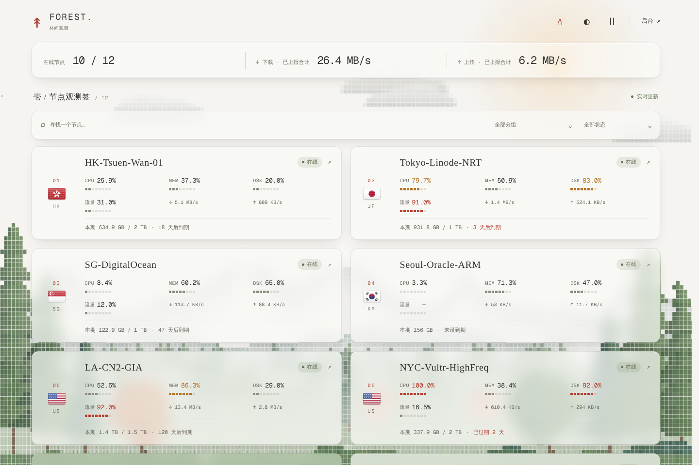
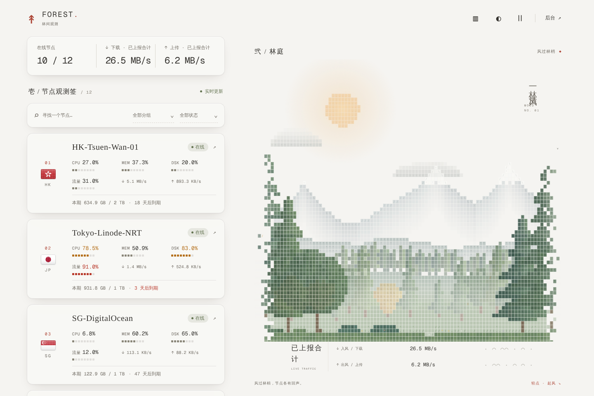
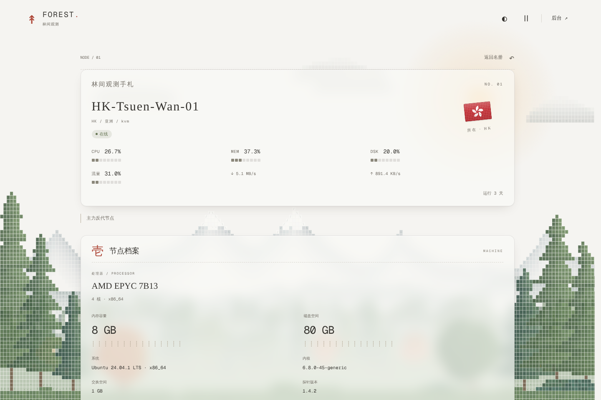
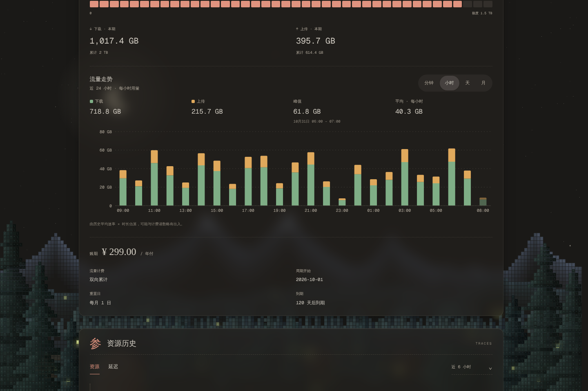
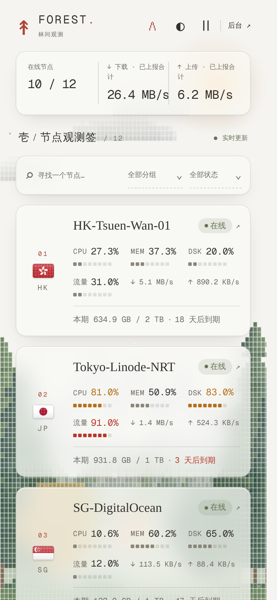
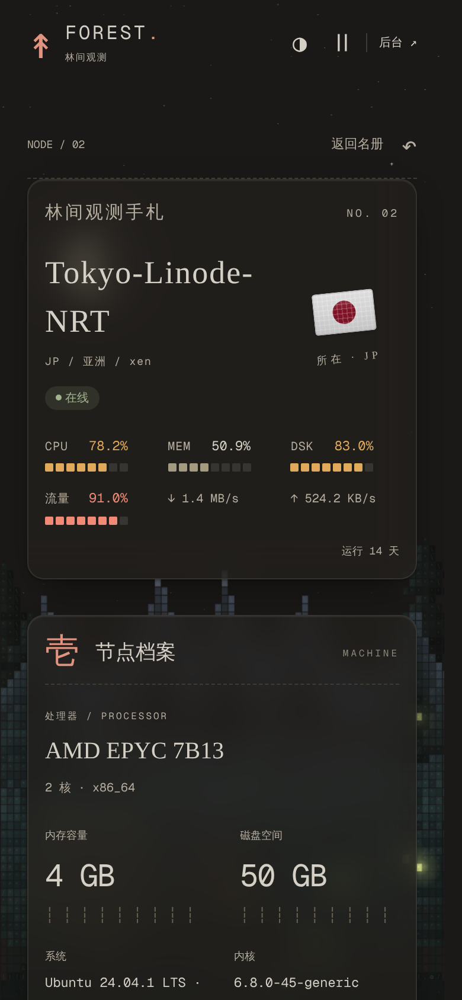

<div align="center">

# 像素林间 · Forest

**风过林梢。**

在一片字符森林里，照看远方的节点。

</div>

**Forest** 是一款适用于 [Monitor](https://github.com/monitor-probe/monitor) 的探针主题。远山、雾气、层层松林和草地都由像素字符拼成；纸白是白天，暖黑是夜晚，节点卡片像一张张毛玻璃浮在林间。

它改自 [锦鲤池塘 · Pond](https://github.com/ayingQAQ/monitor-ascii-pond)：保留了原主题的布局与字符美学，重做了背景和可读性，并加入了流量统计图。喜欢原来的锦鲤，也可以在主题设置里随时切回去。



## 白天与夜晚

- **白天（纸白）**：太阳躲在概览栏的毛玻璃后面，云慢慢飘过，鸟群偶尔掠过天空；风一阵阵从林间吹过，草和树梢跟着倒伏，叶子随风飘落。
- **夜晚（暖黑）**：月亮、闪烁的星星和林间的萤火虫，偶尔划过一颗流星。
- **轻点林间**：白天唤起一阵风、惊起飞鸟；夜晚让萤火虫聚拢过来，点天空会落下一颗流星。

切换配色时，森林会和页面一起淡入淡出。系统开启"减少动态效果"时，森林停在一帧静止画面上。

## 两种显示方式

默认使用全屏森林背景。点击页头配色按钮左侧的 **▥ / ⋀** 图标即可切换，选择会自动记住。

<table>
  <tr>
    <th width="50%">▥ 林庭模式</th>
    <th width="50%">⋀ 全屏森林背景</th>
  </tr>
  <tr>
    <td></td>
    <td></td>
  </tr>
  <tr>
    <td>名册与林庭相伴。右侧是一幅边缘散开的森林小景，下方显示实时上下行速率。</td>
    <td>森林铺在窗口下半部分，节点卡片以毛玻璃浮在上面；滚动页面时前景比远山沉得更快，带一点视差。</td>
  </tr>
</table>

## 看林，也看节点

- **清楚的卡片**：每台服务器一张毛玻璃卡片，边界分明；左侧是所在地的国旗，悬停时恢复全彩，离线时变灰。
- **实时状态**：CPU、内存、磁盘、流量用像素格读数条展示，到 75% 变琥珀色，到 90% 变红；在线、离线、等待上报和异常状态各有标识。
- **流量走势**：节点详情里可按 **分钟 / 小时 / 天 / 月** 查看柱状图，下载与上传叠在一起，附合计、峰值和平均值。
- **搜索与筛选**：按名称、分组、在线状态查找节点，汇总数字随筛选结果变化。
- **资源与延迟**：资源历史曲线；各探测线路的延迟汇聚在同一张图里，保留各自的名称、断点与丢包率。

<table>
  <tr>
    <th width="50%">节点详情 · 纸白</th>
    <th width="50%">流量走势 · 暖黑</th>
  </tr>
  <tr>
    <td></td>
    <td></td>
  </tr>
</table>

流量柱状图由历史记录里的平均速率乘以时长估算，可能与计费读数略有出入。按天、按月能往回看多远，取决于 Monitor 后台保留了多少天历史。

## 小屏幕

手机上节点名册排成单列，两种显示方式都可使用。

<p align="center">
  
  &nbsp;
  
</p>

*以上预览中的节点与数值均为演示数据。*

## 使用

| 操作 | 效果 |
| --- | --- |
| 点击 **▥ / ⋀** | 切换林庭与全屏森林背景 |
| 点击 **◐ / ◑** | 切换纸白（白天）与暖黑（夜晚） |
| 点击 **Ⅱ / ▷** | 暂停或继续林间动态 |
| 轻点林间空白处 | 起风、惊鸟、聚拢萤火虫或落下流星 |
| 点击节点 | 打开节点详情 |
| 点击 **后台 ↗** | 进入 Monitor 管理后台 |

显示方式、配色、暂停与流量统计粒度会保存在当前浏览器中。

## 安装

适用于 **Monitor 的自定义主题功能**，需要已有的 Monitor 站点。

1. 从 [Releases](https://github.com/C2jeremy/monitor-ascii-pond/releases/latest) 下载主题安装包 `theme.tar.gz`，无需解压；也可以在后台直接填写本仓库地址安装。
2. 进入 Monitor 后台，在主题管理中上传安装包。
3. 选择并启用 **像素林间 · Forest**，按需调整主题设置。

本主题的标识是 `monitor-forest`，与原版锦鲤池塘（`monitor-pond`）互不覆盖，可以同时安装。

### 主题设置

| 设置 | 默认值 | 说明 |
| --- | --- | --- |
| 公告 | 空 | 在首页展示一段站点公告 |
| 首页小标题 | 空 | 主标题上方的文字，留空隐藏 |
| 首页标题 | 空 | 首页主标题，留空隐藏 |
| 首页副标题 | 空 | 主标题下方的文字，留空隐藏 |
| 默认背景色 | 跟随系统 | 纸白（白天）、暖黑（夜晚）或跟随系统 |
| 默认显示模式 | 全屏背景模式 | 分栏模式（右侧场景）或全屏背景模式 |
| 背景场景 | 像素森林 | 像素森林或锦鲤池塘 |
| 显示背景动画 | 开启 | 关闭后只保留纯色背景 |
| 允许点击互动 | 开启 | 森林里起风、萤火虫；池塘里投喂 |
| 显示到期信息 | 开启 | 控制节点到期信息的展示 |

后台设置决定访客首次打开页面时的配色与显示方式。访客手动切换过后，优先使用当前浏览器保存的个人选择。

## 本地开发

```bash
npm ci
npm run dev:mock      # 使用模拟数据预览，无需 Monitor 后端
npm run package       # 构建并打包 theme.tar.gz
```

`npm run dev` 会把 `/api` 代理到 `MONITOR_HUB`（默认 `http://127.0.0.1:9911`）。

## 开源许可

本项目采用 [MIT License](LICENSE)，欢迎使用、修改和分享。再分发时，请保留相应的版权与许可声明。

Geist Mono 字体采用 [SIL Open Font License](licenses/GEIST-OFL.txt)；monitor-mc 的许可见 [MIT 声明](licenses/MONITOR-MC.txt)，国旗图标来自 [country-flag-icons](https://github.com/catamphetamine/country-flag-icons)，其他开源组件见 [第三方许可](THIRD_PARTY_NOTICES.txt)。

## 致谢

- **[ayingQAQ/monitor-ascii-pond](https://github.com/ayingQAQ/monitor-ascii-pond)**：本主题的原型。页面布局、节点手札、字符美学与锦鲤池塘场景都来自它。
- **[stqfdyr/ascii-pond](https://github.com/stqfdyr/ascii-pond)**：字符锦鲤、游动、水波与投喂效果的出处，相关版权与许可声明保留于 [ASCII-POND.txt](licenses/ASCII-POND.txt)。
